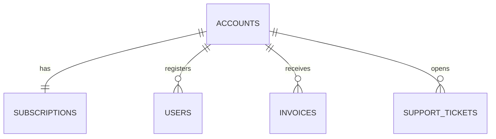

# Global B2B SaaS Revenue Intelligence

An independent data analytics portfolio project using SQL, Python and a Power BI implementation guide.

This project analyses a simulated business-to-business software subscription company with **1,200 customer accounts across 10 countries**. It examines where recurring revenue comes from, how much invoiced value has been paid, which customer groups have higher historical churn, and how support and seat registration vary across accounts.

## Results at a glance

| Metric | Result | How to read it |
| --- | ---: | --- |
| Contracted monthly recurring revenue (MRR) | $1,285,316 | Monthly subscription value at the year-end snapshot across 894 active or past-due accounts |
| Annualised run rate (ARR) | $15,423,792 | Year-end MRR multiplied by 12 |
| 2025 non-void billings | $11,392,291 | Total invoice value after excluding void invoices |
| Paid invoice value | $10,336,551 (90.73%) | Dollar value of paid invoices as a share of non-void billings |
| Open invoice value | $973,750 | Invoice value marked open, which may include invoices still within payment terms |

All amounts are in USD. ARR represents the annualised value of the year-end subscription snapshot. Billings measure invoices issued in 2025. Recognised revenue would require additional accounting data.


## What the analysis found

### Revenue is concentrated in two plans

Business and Enterprise contribute **80.9% of contracted MRR**. A revenue team could prioritise renewal reviews for those plans and track how much recurring revenue is exposed to individual accounts as their renewal dates approach.

### Starter accounts show the highest historical churn

**34.8% of Starter accounts** had churned by the snapshot, compared with **8.2% of Enterprise accounts**. These proportions use all accounts in each plan as the denominator, including trial accounts. Account ages differ across plans, so compare similarly aged cohorts before deciding whether to test a Starter onboarding change.

### January customers billed differently by December

The analysis follows the same accounts that had non-void invoices in January 2025. It divides those accounts’ December non-void billings by their January non-void billings.

| Plan | December billings as a share of January billings |
| --- | ---: |
| Starter | 75.0% |
| Growth | 85.5% |
| Business | 101.9% |
| Enterprise | 99.2% |

Business finished slightly above its January billing level. Starter finished substantially below it. Breaking the change into expansion, contraction and cancellations would help explain which accounts drove each result. This measure uses invoice values as a proxy for retention because historical subscription snapshots are unavailable.

### Open invoices need an ageing review

Start with the **$973,750 in open invoices** and group them by age and applicable payment terms. This helps distinguish amounts that call for collection follow-up from recent invoices that may still be within terms.

### Support scores and seat registration suggest follow-up questions

- **Customer satisfaction (CSAT)** averaged **3.79** for tickets from churned accounts and **4.05** for tickets from active accounts. Each rated ticket contributes to the average. Compare similar plans and account ages and check how many ratings are missing before drawing conclusions about support quality or its relationship to churn.
- **Seat registration** was **70.77%** among active and past-due accounts. The measure compares registered users with licensed seats. Product activity data would be needed to assess actual usage. Accounts with low registration could be candidates for adoption outreach.

### Country comparisons describe the simulated accounts

| Country | Accounts | Contracted MRR |
| --- | ---: | ---: |
| Germany | 120 | $230,441 |
| Japan | 62 | $70,252 |
| Ireland | 51 | $18,212 |

Ireland’s historical churn was **33.3%** in the simulation. The country groups vary in size, and Singapore is outside this dataset’s coverage. These figures describe the sample and do not generalise to real markets.

## Dataset and data model

The [Misata B2B SaaS Subscription Analytics dataset](https://www.misata.studio/datasets/saas-subscription-analytics) contains synthetic company, user, subscription, invoice and support records. The publisher lists the dataset as public domain (CC0). The supplied archive includes the original README, schema and integrity report.

| Table | Rows | What one row represents |
| --- | ---: | --- |
| `accounts` | 1,200 | One customer account |
| `subscriptions` | 1,200 | One subscription per account |
| `users` | 25,002 | One registered user |
| `invoices` | 7,892 | One invoice |
| `support_tickets` | 6,946 | One support ticket |
| **Total** | **42,240** | |



Invoices and support tickets cover 2025. The subscription status and contracted revenue metrics use the end-of-2025 snapshot. Timestamps are parsed in UTC.

## How the analysis works

1. **Inspect the raw data.** Load the five CSVs, review types and missing values, and check for duplicate records.
2. **Check relationships and pricing.** Confirm that primary keys are present and unique, each child record resolves to an account, every account has one subscription, contracted MRR matches seats multiplied by plan price, and registered users do not exceed licensed seats.
3. **Aggregate before joining.** Summarise invoices, registered users and support tickets at account level before combining them with account and subscription data. Joining all raw rows together can count the same invoice once for every matching user and support ticket.
4. **Calculate business metrics.** Compare revenue, collections, churn, retention, support and registration across plans and countries. Preserve missing ratings and unresolved tickets so each calculation uses its intended denominator.
5. **Export and cross-check.** The Python notebook exports summary CSVs and charts. The SQLite queries independently reproduce the core business metrics.

### KPI reference

| KPI | Calculation |
| --- | --- |
| Contracted MRR | Sum subscription MRR for active and past-due accounts |
| ARR | Contracted MRR × 12 |
| Average revenue per account (ARPA) | Contracted MRR ÷ active and past-due accounts |
| Historical churn | Churned accounts ÷ all accounts, including trials |
| January cohort billing retention | December non-void billings from January-billed accounts ÷ their January non-void billings |
| Billings | Sum of non-void invoice values |
| Collection rate | Paid invoice value ÷ non-void invoice value |
| Open invoice value | Sum of invoice values with open status |
| CSAT | Mean satisfaction score across rated tickets |
| Resolution time | Mean hours to resolve across resolved tickets |
| Resolution rate | Resolved tickets ÷ all tickets |
| Seat registration | Registered users ÷ licensed seats across active and past-due accounts |
| Billing concentration | Billings from the top 20% of billed accounts, rounded up to a whole account, ÷ total billings |

## Exploratory churn classification

The notebook also compares three approaches for classifying historical churn. It uses country, industry and employee count, with a stratified 80/20 split of **960 training accounts** and **240 held-out accounts** (seed 42). Preprocessing is fitted on training rows only.

| Approach | Churn recall | Churn F1 | ROC-AUC |
| --- | ---: | ---: | ---: |
| Majority-class baseline | 0.00% | 0.000 | 0.500 |
| Balanced logistic regression | 61.02% | 0.391 | 0.556 |
| Shallow random forest | 54.24% | 0.421 | 0.642 |

The baseline achieved **75.42% accuracy** while identifying zero churned accounts. Logistic regression identified a larger share of churned accounts at its evaluated decision threshold. Random forest had the highest ROC-AUC, meaning it ranked churned accounts better overall in this comparison. Its discrimination was still limited.

The project evaluates historical classification. Account attributes may have changed after signup, and the dataset lacks timestamped feature snapshots. A future prediction study would need features captured before the prediction date and evaluation on later cohorts before any operational use. The exported results are in `data/processed/model_metrics.csv` after extraction.

## Run the project locally

Place the two ZIP archives, the notebook, the SQL script, `PowerBI.txt` and `requirements.txt` in the same project folder. Extract `Raw_Data.zip` and `Results_and_Visualisations.zip` there, preserving their internal paths.

| File | What to use it for |
| --- | --- |
| `Raw_Data.zip` | Source CSVs and dataset documentation |
| `Results_and_Visualisations.zip` | Generated results and charts |
| [saas_analysis.ipynb](saas_analysis.ipynb) | Python inspection, validation, analysis, charts and churn classification |
| [analysis.sql](analysis.sql) | SQLite queries for the core business metrics |
| [PowerBI.txt](PowerBI.txt) | Power BI build instructions and DAX measures |
| [requirements.txt](requirements.txt) | Python dependencies |

### 1. Run the Python notebook

Use Python 3.10 or newer. From the project folder, keeping the notebook at the root, run:

```bash
python -m pip install -r requirements.txt
jupyter notebook saas_analysis.ipynb
```

Run all cells in order. Review the data checks before the KPI and model outputs. If your copy places the notebook under `notebooks/`, use `jupyter notebook notebooks/saas_analysis.ipynb` from the project root.

### 2. Run the SQL analysis

Create a local SQLite database. Import the five raw CSVs using their filenames without `.csv` as table names. Preserve numeric types for values such as seats, MRR, invoice amounts and satisfaction scores. Run `analysis.sql` against that database using a SQLite client or Python’s built-in `sqlite3` module. If the script is under `sql/`, open `sql/analysis.sql`.

Compare the SQL and notebook results for key totals such as contracted MRR and non-void billings. When investigating differences, check the snapshot, included statuses and denominators first.

### 3. Build the Power BI report

On Windows, open Power BI Desktop and follow [PowerBI.txt](PowerBI.txt) to import the tables, set up relationships and add DAX measures. Use the planned three report pages to present revenue, billing and customer metrics. The supplied project records validation of Python and SQLite outputs. The DAX measures still need to be checked in Power BI Desktop.

## Validation and scope

The supplied project notes record that all **98 notebook code cells** and **eight SQLite queries** ran successfully. The notebook checks key integrity, subscription coverage, pricing and seat counts. The figures in this README come from those project results.

- The dataset is synthetic, so the findings illustrate analytical methods and possible business decisions.
- Historical churn counts churned accounts at the snapshot. A monthly churn rate requires a monthly population at risk.
- Historical subscription snapshots and payment timestamps are unavailable, which limits retention and payment-timing analysis.
- The data lacks usage events, acquisition costs and operating costs. Active usage, customer acquisition cost, profitability and true customer lifetime value are outside the analysis.
- Missing ticket ratings and differences in account age, plan and country sample sizes can influence comparisons.

The results point to three follow-up actions to validate with operational data: review Business and Enterprise renewals, compare Starter onboarding outcomes across similar cohorts, and age open invoices before collection follow-up.
