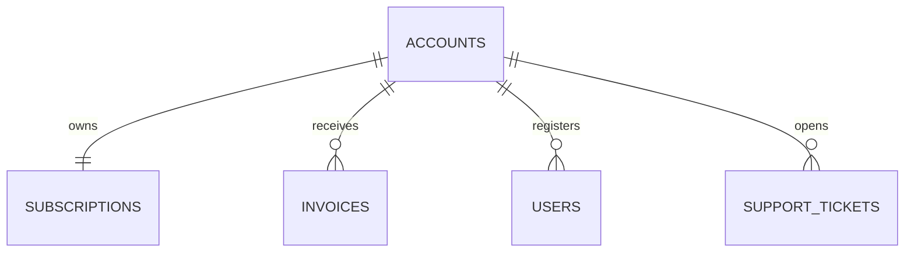

# Global B2B SaaS Revenue Intelligence
Independent intermediate portfolio project | SQL • Python • Power BI implementation guide

## Business objective
Analyse recurring revenue, retention, billing and support across 1,200 simulated accounts in ten countries.


## Key findings and business recommendations

- Contracted MRR is $1,285,316 across 894 active or past-due accounts; annualised run rate is $15,423,792, not actual annual revenue.
- Enterprise and Business contribute 80.9% of MRR. Protect these accounts through proactive renewal reviews; monitor concentration risk.
- Starter historical churn proportion is 34.8%, versus 8.2% for Enterprise. Test improved onboarding for Starter; account ages differ, so this is not a causal comparison.
- January cohort billing retention is 75.0% Starter, 85.5% Growth, 101.9% Business and 99.2% Enterprise. Investigate contraction and cancellation separately before setting targets.
- Non-void 2025 billings total $11,392,291; paid value $10,336,551 (90.73%); open invoices $973,750. Review open invoices by age; open does not automatically mean overdue.
- Ticket-weighted satisfaction is 3.79 for churned accounts versus 4.05 for active accounts. Investigate support quality, controlling for plan and account age; no causal claim.
- Germany: 120 accounts, $230,441 MRR; Japan: 62, $70,252; Ireland: 51, $18,212. Ireland has 33.3% historical churn; small samples and simulated data prevent real market conclusions. Singapore is absent.
- Registered seats proxy is 70.77% among live accounts; registration is not active usage. Test adoption outreach, not automatic seat reductions.

## Reproduce
See the setup instructions below, [notebook](saas_analysis.ipynb), [SQL](analysis.sql), [Power BI guide and DAX](PowerBI.txt), and the consolidated documentation below. No actual company affiliation or realised savings claimed.

## Extended Python analysis
The executed notebook contains 98 code cells with separate inspection, cleaning, descriptive statistics, visualisation and modelling stages. Random forest achieved held-out ROC-AUC 0.642 versus logistic regression 0.556 and baseline 0.500. This is retrospective classification, not validated future churn prediction. See `data/processed/model_metrics.csv`.

## Methodology
Read five CSVs, parse UTC timestamps, validate unique keys and foreign keys, verify one subscription per account and seat pricing. Aggregate child tables separately before joining. Preserve missing ratings and unresolved tickets. Use non-void invoice values for billing metrics. Group by plan and country; compare January cohort December billing; compare ticket-weighted satisfaction by status. Export aggregate CSVs and charts. SQL independently reproduces core metrics.

### Extended notebook
Separate cells cover loading, info, describe, missingness, duplicate checks, descriptive statistics, visualisations and retrospective churn classification. A stratified 80/20 split (960/240 accounts, seed 42) compares a majority baseline, balanced logistic regression and shallow random forest using country, industry and employee count. Preprocessing is fitted on training data only. Model metrics are exported separately; SQL and Power BI business KPIs are unchanged.

## Machine learning results and inferences
On 240 held-out accounts, baseline accuracy was 75.42% with zero churn recall. Logistic regression achieved 61.02% recall, F1 0.391 and ROC-AUC 0.556. Random forest achieved 54.24% recall, F1 0.421 and ROC-AUC 0.642. The forest had the highest observed AUC, but discrimination remains limited. Do not deploy either model; collect timestamped customer behaviour and validate on future cohorts.

## Executive decision
Prioritise retention experiments and billing follow-up; validate on real operational data before implementation.

Exploratory churn classification: random forest test ROC-AUC 0.642; logistic regression 0.556. Limited discrimination and absent historical feature snapshots prevent operational use.

## Eight-file package setup
Extract `Raw_Data.zip` and `Results_and_Visualisations.zip` into this folder, preserving paths. Keep the notebook and SQL in the root or move them into `notebooks/` and `sql/` respectively if following the original setup commands below.

---

## data/README.md

# Data provenance
Source: uploaded Misata B2B SaaS subscription analytics archive. Original README, schema and integrity report retained. Publisher states public domain; synthetic data. Source page: https://www.misata.studio/datasets/saas-subscription-analytics (as recorded in supplied files). Raw data unchanged; processed files generated by notebook. No independent legal verification performed.


---

## data/data_licence.md

Publisher supplied README states public domain. Retain source attribution. This statement applies to supplied data, not third-party software.


---

## data/source_README.md

# B2B SaaS subscription analytics

A B2B software company's accounts, users, subscriptions, a year of invoices (2025) and its support queue: 1,200
accounts in 10 countries, 25,002 users, 7,892 invoices and 6,946 support tickets. 42,240 rows, free
and public domain.

| table | rows | columns |
| --- | --- | --- |
| `accounts` | 1,200 | 7 |
| `users` | 25,002 | 5 |
| `subscriptions` | 1,200 | 7 |
| `invoices` | 7,892 | 5 |
| `support_tickets` | 6,946 | 8 |

## What holds, and how it was checked

Measured with DuckDB against these exact files. Full output in `INTEGRITY.txt`.

- **Zero orphaned rows** on all four relationships, **zero duplicate keys**, and exactly one subscription per account.
- **mrr is seats × the plan's seat price, to the cent**, for all 1,200 (Starter $12, Growth $24, Business $44,
  Enterprise $79 a seat a month). Every invoice is a whole number of seats at that price, and a live account's latest
  invoice equals its mrr.
- **No account licenses more seats than it has employees**, and none has more users than seats. Median seats rise with
  the plan: Starter 8, Growth 23, Business 42, Enterprise 92.
- **Dates are in order.** Nothing is dated before its account signed up, no invoice falls inside the 14-day trial, and
  nothing is dated after a churned subscription ended. Churned subscriptions, and only they, carry an end date.
- **One invoice a month**, on the same day and to the same second each month: the anniversary of the trial's end.
- **Every user has a unique work email** on their own company's domain.
- **All times are UTC**, as a SaaS database stores them. Each account's activity follows its own local clock, so a
  sales-led signup's median hour is 2:00 UTC in Japan, 13:00 in the United Kingdom and 18:00 in the
  United States.

## How it behaves

- **Company size decides the plan.** Median employees run Starter 11, Growth 35, Business 79, Enterprise 124. Accounts: Starter 466, Growth 451, Business 234, Enterprise 49.
- **Self-serve and sales-led buy differently.** Starter and Growth are bought at any hour (12% of signups at the
  weekend); Business and Enterprise are signed in office hours (1% at the weekend), and pay by invoice on
  net-30 terms, so 88% of the open invoices that are not past due are theirs, all issued from 2 December.
- **Small accounts churn faster.** Monthly logo churn (churned accounts over months paid): Starter 3.9%, Growth 2.2%, Business 0.9%, Enterprise 0.7%. Subscriptions at
  the end of 2025: 864 active, 293 churned, 30 past due, 13 trialing.
- **A few accounts carry the revenue.** The top 20% of billed accounts hold 81% of 2025 billings; by plan
  Starter 2%, Growth 17%, Business 38%, Enterprise 42%. Seats move month to month, so net revenue retention from January to December 2025 is Starter 74%, Growth 85%, Business 102%, Enterprise 99%.
- **Unpaid invoices belong to accounts in trouble.** Invoices: 7,448 paid, 283 open, 119 uncollectible, 42 void. 100% of the uncollectible ones belong to
  accounts that are past due or churned.
- **Support load predicts churn.** Accounts that churned filed 0.056 tickets per user a month and rated support
  3.77 on average; accounts that stayed filed 0.035 and rated 4.11. The busiest 20% of accounts file
  69% of tickets. In an account's first 60 days, 40% of its tickets are about onboarding, against 5% after.
- **Higher priority resolves faster**: median urgent 4 h, high 12 h, normal 34 h, low 77 h. 1.8% of tickets are still open (waiting at the end of the
  year, or left open when the account churned), and none of those carry a score. Scores: 1: 5%, 2: 6%, 3: 13%, 4: 32%, 5: 44%.

The plans, seat prices, company sizes, churn rates, seat changes, payment terms, ticket rates and satisfaction were
authored for this dataset. They are estimates of how a B2B SaaS business behaves, not figures from a real one.

## Questions it can answer

- Does support load predict churn?
- What is net revenue retention by plan tier?
- Which industry has the worst satisfaction scores?
- How does seat utilisation (users over seats) vary between Starter and Enterprise?

## Make your own version

`schema.yaml` is the shape of this dataset, and it runs:

```bash
pip install misata
misata generate --config schema.yaml --output-dir ./data
```

That regenerates the five tables at any size, with every foreign key resolving (checked: 0 orphans across all four
relationships). It covers the structure only. The behaviour above (monthly billing, churn, support load, UTC clocks)
comes from the Misata engine, which made these files at seed 20260722. To get one shaped like your own business, describe
it at https://www.misata.studio/app.

## Provenance

No real company, person or invoice exists here, and nothing was sampled from a real dataset. Company names, people and
emails are invented.

Public domain (CC0). No signup, no attribution required.


---

## docs/business_requirements.md

# Business problem
Management needs to understand contracted recurring revenue, billing collection, customer retention and support quality by plan and country.
## Questions
Which plans drive MRR? Which segments have higher historical churn? How much of January cohort billing remains in December? Is satisfaction associated with churn? Which invoices need review?
## Acceptance criteria
Reconcile KPIs across Python and SQL; preserve table grain; build three Power BI pages; document limitations and recommendations.


---

## docs/data_model.md

# Data model

Grain: one row per account, subscription, invoice, user or ticket respectively. Aggregate facts before joining.


---

## docs/kpi_definitions.md

# KPI definitions
All currency USD. Snapshot end 2025; invoices and tickets cover 2025.
| KPI | Definition |
|---|---|
| MRR | Sum mrr for active and past_due |
| ARR | MRR x 12 |
| ARPA | MRR / active and past_due accounts |
| Historical churn | churned / all accounts, including trials |
| Billing retention proxy | December non-void billings for January non-void billed cohort / January non-void billings |
| Billings | Sum non-void invoices |
| Collection | paid amount / non-void amount |
| Open amount | sum open invoices |
| CSAT | mean non-null ticket satisfaction |
| Resolution time | mean hours for resolved tickets |
| Resolution rate | resolved tickets / all tickets |
| Seat registration | registered users / licensed seats for live accounts |
| Concentration | top ceil(20% of billed accounts) billings / total billings |


---

## docs/limitations.md

# Limitations
Synthetic dataset; no real employer or country market conclusions. No acquisition cost, operating cost, usage events, payment timestamps or historical subscription snapshots; cannot calculate CAC, profit, true CLV, active usage, recognised revenue or true NRR. Historical churn is not monthly churn. Open invoices may not be overdue. Support association is not causation; missing ratings may bias results. Country sample sizes differ.

Churn classification is retrospective, not prospective: profile features may have changed after signup. No timestamped feature snapshots or external validation exist. Held-out test scores are descriptive comparisons, not evidence of deployment readiness.


---

## docs/setup_instructions.md

# Run locally
Install Python 3.10+; run `pip install -r requirements.txt`, then `jupyter notebook notebooks/saas_analysis.ipynb`. Run all cells. For SQL use SQLite (Python standard library or DB Browser for SQLite): import each raw CSV as its filename stem, with numeric columns numeric, then run sql/analysis.sql. Power BI Desktop on Windows: follow powerbi/BUILD.md.


---

## tests/validation.md

Notebook assertions passed: primary keys unique/non-null, foreign keys resolve, one subscription per account, plan pricing matches MRR, registered users do not exceed seats. All eight SQL queries executed successfully against SQLite imported CSVs.

Revised notebook executed all 98 code cells without errors. Existing KPI outputs regenerated. Model preprocessing fitted on training rows; stratified split 960/240 accounts. DAX remains untested in Power BI Desktop.

